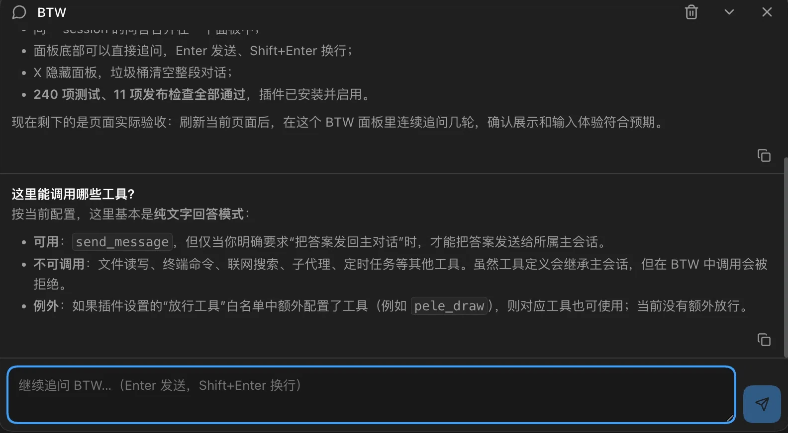

# DSH BTW Continuity

Perguntas secundárias contínuas no DeepSeek Harness: um painel cronológico por sessão, follow-ups diretos e sem interromper a tarefa principal.

[简体中文](README.zh-CN.md) · [English](README.en.md) · [日本語](README.ja.md) · [Español](README.es.md) · [Français](README.fr.md) · [Deutsch](README.de.md) · [Русский](README.ru.md) · Português

> **BTW Continuity é uma modificação independente do [MichengAI DSH BTW 1.3.10](https://github.com/MichengAI/dsh-btw)**, licenciada sob Apache-2.0 e sem endosso da DeepSeek AI ou MichengAI. Consulte [NOTICE.md](NOTICE.md) para atribuição e modificações.

## Recursos

- Todas as perguntas e respostas BTW de uma sessão aparecem em um único painel cronológico.
- O campo inferior permite perguntar diretamente: Enter envia e Shift+Enter insere uma nova linha.
- O campo começa com uma linha, cresce até quatro e depois rola internamente; volta a uma linha após o envio.
- X apenas oculta o painel; a próxima pergunta restaura o histórico visível.
- O ícone de lixeira apaga o histórico BTW da sessão atual e permite recomeçar.
- As respostas ficam fora da conversa principal por padrão; `send_message` só é usado quando solicitado explicitamente.
- Respostas somente leitura, perguntas sobre texto selecionado, Markdown, fórmulas, cópia e oito idiomas.

## Interface atual



## Pré-requisitos

- DeepSeek Harness `>=0.2.0-rc.1 <0.3.0-0`
- Node.js 22+
- Um provedor de modelo configurado

**Não instale nem ative este pacote junto com `@michengai/dsh-btw`**, pois ambos registram `/btw`.

## Instalação

Substitua `desktop` pelo seu perfil real:

```bash
dsh plugin --profile desktop add dsh-btw-continuity@latest --registry=https://registry.npmjs.org/
```

Se a ativação não for automática, recarregue o aplicativo de desktop ou reinicie o serviço DSH correspondente.

## Uso

```text
/btw Resuma a proposta atual em uma frase
```

Você também pode escolher `btw` no menu `/` ou usar **Perguntar ao BTW** em texto selecionado.

Expanda o painel e use o campo inferior. Follow-ups no painel e `/btw` compartilham o mesmo histórico.

| Ação | Comportamento |
| --- | --- |
| X | Oculta o painel sem apagar o histórico; a próxima pergunta o restaura. |
| Lixeira | Apaga todo o histórico BTW desta sessão e remove o painel. |
| Copiar | Copia o Markdown original da resposta correspondente. |

## Histórico e privacidade

- Solicitações posteriores incluem turnos BTW concluídos e o contexto da sessão principal, o que pode aumentar o uso de tokens.
- As solicitações são enviadas apenas ao provedor configurado; nenhum destinatário terceiro adicional é introduzido.
- O histórico fica na memória do Host e é perdido quando ele reinicia. Copie as respostas que precisar manter.

## Configurações

Em **Plugins → BTW Continuity → Configurar**, você pode permitir ferramentas além de `send_message` (uma por linha) e substituir o prompt integrado. O padrão é somente texto.

## Desinstalação

```bash
dsh plugin --profile desktop remove dsh-btw-continuity
```

## Desenvolvimento

```bash
npm ci --ignore-scripts
npm run check
```

## Licença

[Apache-2.0](LICENSE) · [Atribuição e modificações](NOTICE.md)
